<p align="center">
  
</p>

<p align="center">
  
</p>

<p align="center">
  <a href="https://t.me/mortezaiccy"></a>
  <a href="mailto:mortezaiccy@gmail.com"></a>
  
</p>

---

## 👋 About me

I'm a developer from Iran who enjoys building the parts of a product people don't see but always feel: fast APIs, well-designed databases, and systems that stay up when traffic spikes.

Most of my work is in **PHP and Laravel** on the backend and **Lua** for scripting and server-side logic. When a project needs a UI, I build it with **Vue** or **Svelte**. I care about readable code, sensible data models, and leaving things easy for the next developer to work on.

```php
<?php

class Morteza extends Developer
{
    public string $basedIn    = 'Iran · UTC+3:30';
    public array  $coreStack  = ['PHP', 'Laravel', 'Lua', 'Vue', 'MySQL'];
    public string $enjoys     = 'Turning slow, messy systems into fast, clean ones';
    public bool   $openToWork = true;
}
```

## 🧭 What I work on

<p align="center">
  
</p>

## 🛠️ Tech stack

<p align="center">
  
</p>

## 📊 GitHub stats

<p align="center">
  
  
</p>

## 🗓️ Contribution graph

<p align="center">
  <picture>
    <source media="(prefers-color-scheme: dark)" srcset="./profile/snake-dark.svg" />
    <source media="(prefers-color-scheme: light)" srcset="./profile/snake-light.svg" />
    
  </picture>
</p>

## 📬 Let's work together

I'm open to freelance and contract work, especially backend, API, and Lua projects. If you have something in mind, Telegram is the fastest way to reach me. I'm on Tehran time (UTC+3:30).

<p align="center">
  <a href="https://t.me/mortezaiccy"></a>
  <a href="mailto:mortezaiccy@gmail.com"></a>
</p>


